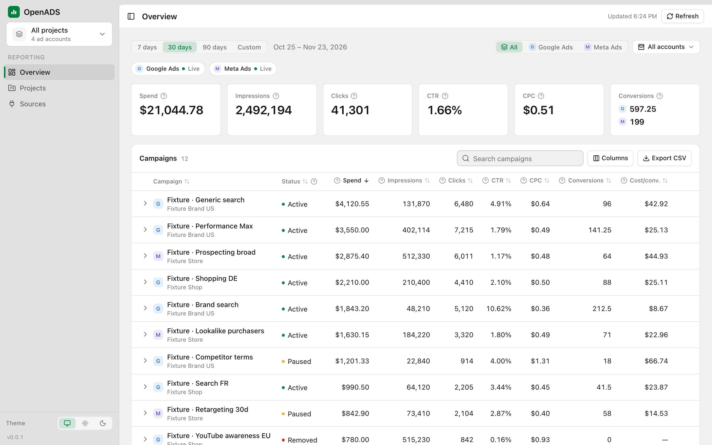
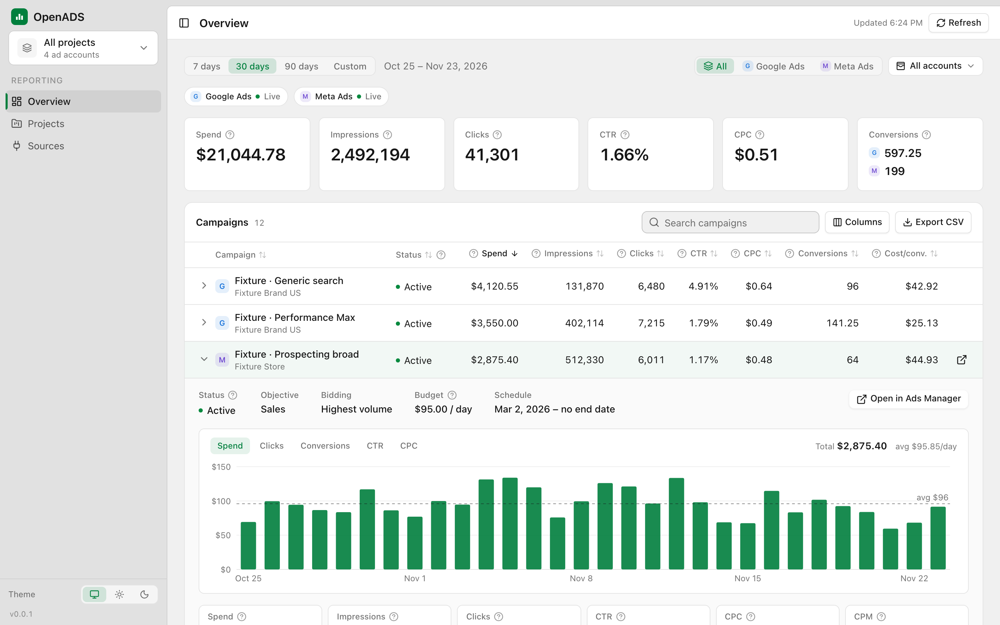

<p align="center">
  
</p>

<h1 align="center">OpenADS</h1>

<p align="center">
  <strong>Open-source, self-hosted ad reporting for Google Ads and Meta Ads.</strong>
</p>

<p align="center">
  <a href="LICENSE"></a>
  <a href="CHANGELOG.md"></a>
</p>

<p align="center">
  <a href="docs/SELF_HOSTING_CLOUDFLARE.md">Self-hosting</a>
  ·
  <a href="docs/SELF_HOSTING_GOOGLE_ADS.md">Google Ads setup</a>
  ·
  <a href="docs/SELF_HOSTING_META_ADS.md">Meta Ads setup</a>
  ·
  <a href="CHANGELOG.md">Changelog</a>
</p>

<br />

<p align="center">
  
</p>

## Why OpenADS

Looking at Google Ads and Meta Ads side by side usually means two ad managers
in two tabs, or handing your ad accounts to a third-party reporting SaaS.
OpenADS is a small dashboard you run yourself: one view of your campaigns
across both platforms, on your own Cloudflare account, behind your own login,
with your own Google and Meta apps.

- **Yours to run.** Each instance lives in its owner's Cloudflare account. No
  shared OAuth app, no broker, no hosted backend in between.
- **Honest numbers.** Spend is shown per currency and conversions per platform;
  nothing is converted or summed across them. A value a platform did not report
  shows `—`, never 0, and a partially failed report says so.
- **Read-only.** OpenADS reads reports. It never creates, edits or pauses
  anything in your ad accounts.

## Features

- **Google Ads** and **Meta Ads** reporting in one dashboard, read live from the
  official APIs.
- **In-app setup wizards** for your own Google Cloud OAuth client and your own
  Meta app: step by step, with links to the right console page, copy buttons and
  checks of what you paste. No redeploy.
- **Account pickers** for both platforms: Google manager-account children,
  Meta business portfolios, search, up to 25 accounts per platform.
- **Projects** group the ad accounts of one brand or client. A sidebar switcher
  scopes the dashboard, and suggestions group accounts with matching names.
- **Campaign reporting**: KPI cards (spend and CPC per currency, impressions,
  clicks, CTR, conversions per platform), a sortable, searchable campaign table
  with optional columns, CSV export, and date, platform and account filters kept
  in the URL.
- **Drill-down**: expand a campaign for budget, schedule, a daily trend chart (spend, clicks, conversions, CTR, CPC),
  all metrics and the top ad sets / ad groups, with links that open
  the campaign in Ads Manager or the account in Google Ads.
- **Clear source status**: live, not configured, unavailable or partial, with
  one action to fix each (for example "Reconnect" before a Meta token expires).
- **Access control** by Cloudflare Access, with admins (set up and connect
  sources) and members (read reports).
- **One-command Cloudflare deploy**: `npm run deploy:cloudflare`.

<p align="center">
  
</p>

## How it works

```
Browser ──► Cloudflare Access ──► OpenADS Worker ──► Google Ads API / Meta Marketing API
               (sign-in)            │   (read-only, live)
                                    ▼
                                    D1  (workspace, selected accounts, projects,
                                         encrypted OAuth grants — never report data)
```

- **Cloudflare Access** signs people in and checks every request (pages, API,
  static files) before it reaches OpenADS. The Worker verifies Access's signed
  token again on every request and checks the address against its own allowlist.
- **The Worker** (TanStack Start, React, Tailwind, Base UI) serves the dashboard
  and calls the provider APIs live, server-side, when you open a report.
- **D1** stores only workspace membership, the selected ad accounts, projects,
  setup progress and the provider grants. OAuth client secrets and tokens are
  encrypted with `TOKEN_ENCRYPTION_KEY` (AES-256-GCM) and never sent to the browser.
- **Your own OAuth apps**: a Google Cloud project with the Google Ads API and a
  Meta app in Development mode, both owned by you.

## Quick start

You need Node 26.13+, a Cloudflare account with a domain on it, and a free
Zero Trust organization. Full guide: [Cloudflare self-hosting](docs/SELF_HOSTING_CLOUDFLARE.md).

1. Get the code and log in to Cloudflare:

   ```sh
   git clone https://github.com/RapidWombat-com/OpenADS.git
   cd OpenADS
   npm ci --ignore-scripts
   npx wrangler login
   ```

2. Create a **Cloudflare Access** application (Self-hosted) for your host name,
   e.g. `openads.example.com`, with an Allow policy for your team, and copy its
   Audience (AUD) tag.
3. Fill in the deploy settings:

   ```sh
   cp deploy/.env.cloudflare.example deploy/.env.cloudflare
   # edit: account ID, host name, team domain, AUD tag, allowed and admin emails
   ```

4. Deploy (check first with `-- --plan`):

   ```sh
   npm run deploy:cloudflare
   ```

   It creates the D1 database, applies migrations, generates the encryption key,
   deploys to your host name and checks that Access protects it.
5. Open `https://openads.example.com` → **Sources** → **Set up Google Ads** /
   **Set up Meta Ads** and follow the wizards
   ([Google Ads guide](docs/SELF_HOSTING_GOOGLE_ADS.md),
   [Meta Ads guide](docs/SELF_HOSTING_META_ADS.md)).

Run the same command again to update. Deployment is always manual, from your
own machine: this repository has no CI/CD and nothing deploys on push.

## Local development

```sh
npm ci --ignore-scripts
npm test                    # type check + unit tests
npm run build
npm run test:integration    # the built Worker, end to end, against fake providers
WRANGLER_SEND_METRICS=false npm run dry-run
```

Run the built app locally with a local D1 and fixture Google/Meta (both wizards,
consent stand-ins, error and expiry scenarios; nothing reaches the internet):

```sh
npm run preview:local -- --fixtures
```

Or against your real Google and Meta accounts:
`npm run preview:local -- --live --email you@example.com`, then open the
one-time sign-in link it prints (`http://127.0.0.1:8788/?preview_token=…`; it
listens on 127.0.0.1 only and answers 401 to anything without that link's
cookie). Architecture, security model, CSP and API contract:
[`docs/dev.md`](docs/dev.md).

## Configuration

Set in `deploy/.env.cloudflare` (see [`deploy/.env.cloudflare.example`](deploy/.env.cloudflare.example));
the deploy turns them into Worker vars and secrets.

| Setting | Required | Description |
| --- | --- | --- |
| `CLOUDFLARE_ACCOUNT_ID` | yes | Your Cloudflare account ID. |
| `OPENADS_HOSTNAME` | yes | Host name in a zone of that account, e.g. `openads.example.com`. Becomes `PUBLIC_ORIGIN`. |
| `ACCESS_TEAM_HOSTNAME` | yes | Zero Trust team domain, e.g. `your-team.cloudflareaccess.com`. |
| `ACCESS_AUDIENCE` | yes | AUD tag of the Access application. |
| `ACCESS_ALLOWED_EMAILS` | yes | Who may sign in: exact addresses (`you@example.com`) and/or whole domains (`@example.com`). |
| `OPENADS_ADMIN_EMAILS` | yes | Exact addresses of the admins, who set up and connect sources. |
| `OPENADS_WORKER_NAME`, `OPENADS_D1_NAME` | no | Default `openads`. |
| `GOOGLE_API_VERSION` | no | Google Ads API version; defaults to the one pinned by this release. |
| `META_APP_ID`, `META_APP_SECRET` | no | Your Meta app from the deployment instead of the in-app wizard. |
| `META_API_VERSION` | no | Graph API version; defaults to the one pinned by this release. |
| `META_CONVERSION_ACTION_TYPE` | no | Meta action type counted as conversions; otherwise chosen on Sources (default `purchase`). |

`TOKEN_ENCRYPTION_KEY` (a Worker secret) is generated by the first deploy and
kept afterwards; back it up
([how](docs/SELF_HOSTING_CLOUDFLARE.md#the-encryption-key)). The Google OAuth client is entered in the app (or set as
`GOOGLE_OAUTH_CLIENT_ID` / `GOOGLE_OAUTH_CLIENT_SECRET`); see the
[Google Ads guide](docs/SELF_HOSTING_GOOGLE_ADS.md#4-give-openads-the-client-and-its-keys).

## Security & privacy

- OpenADS uses the platforms' official OAuth flows: Google OAuth 2.0 with PKCE
  and Facebook Login, with your own apps.
- Read-only: Meta access is limited to `ads_read`. Google Ads has no read-only
  scope, so OpenADS only calls reporting endpoints and never a mutation method.
- No scraping and no browser automation of ad platforms.
- Tokens never leave your instance: grants and secrets are encrypted at rest in
  your D1 database and never reach the browser, responses or logs.
- No telemetry: OpenADS sends nothing anywhere except to the Google and Meta
  APIs you connect. Worker observability is off by default.
- Every request is behind Cloudflare Access and re-verified by the Worker; a
  strict nonce-based Content Security Policy is applied to every page.

Found a vulnerability? See [SECURITY.md](SECURITY.md).

## Roadmap

- Validation against more real-world Google Ads and Meta accounts
- More platforms (e.g. Microsoft Ads, LinkedIn Ads)
- Scheduled snapshots for longer history and faster loads
- Saved views and shareable reports
- Other self-hosting targets besides Cloudflare

## Contributing

Issues and pull requests are welcome. Please read
[CONTRIBUTING.md](CONTRIBUTING.md) first.

## License

OpenADS is licensed under the [GNU Affero General Public License v3.0](LICENSE)
(`AGPL-3.0-only`). Parts of the dashboard are adapted from
[OpenSEO](https://github.com/every-app/open-seo) and
[shadcn/ui](https://github.com/shadcn-ui/ui) under the MIT License; see
[THIRD_PARTY_NOTICES.md](THIRD_PARTY_NOTICES.md).

Google Ads is a trademark of Google LLC; Meta and Facebook are trademarks of
Meta Platforms, Inc. OpenADS is not affiliated with or endorsed by either.

<br />

<p align="center"><sub>Built by <a href="https://rapidwombat.com">RapidWombat</a></sub></p>
